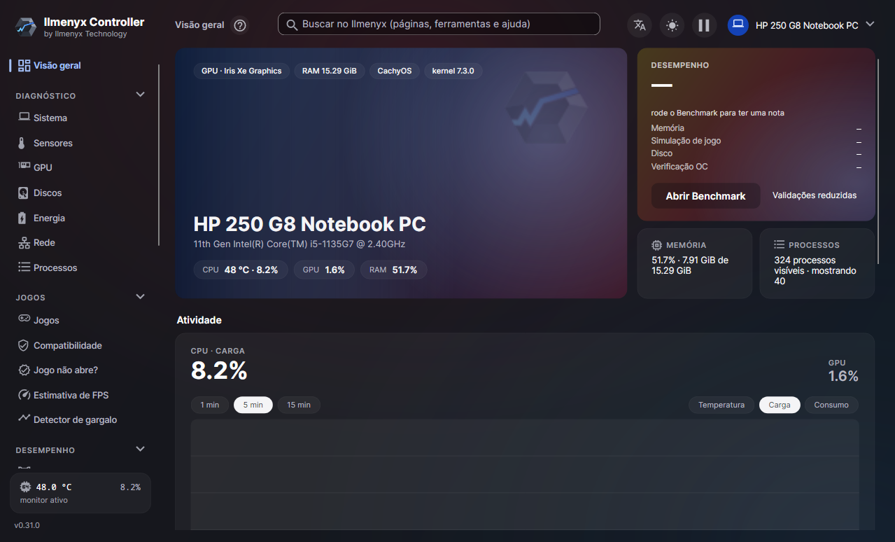
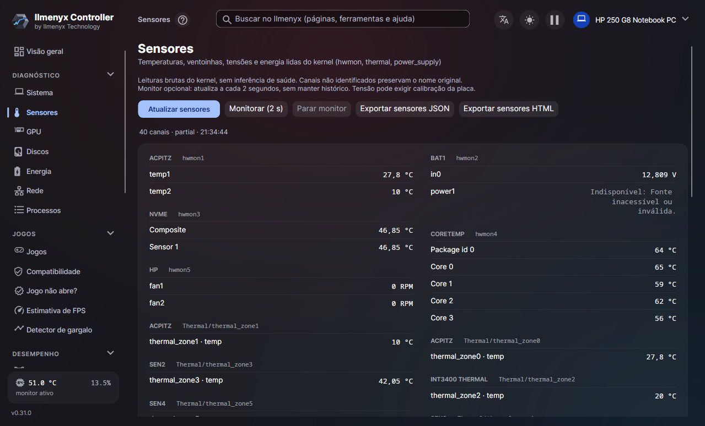
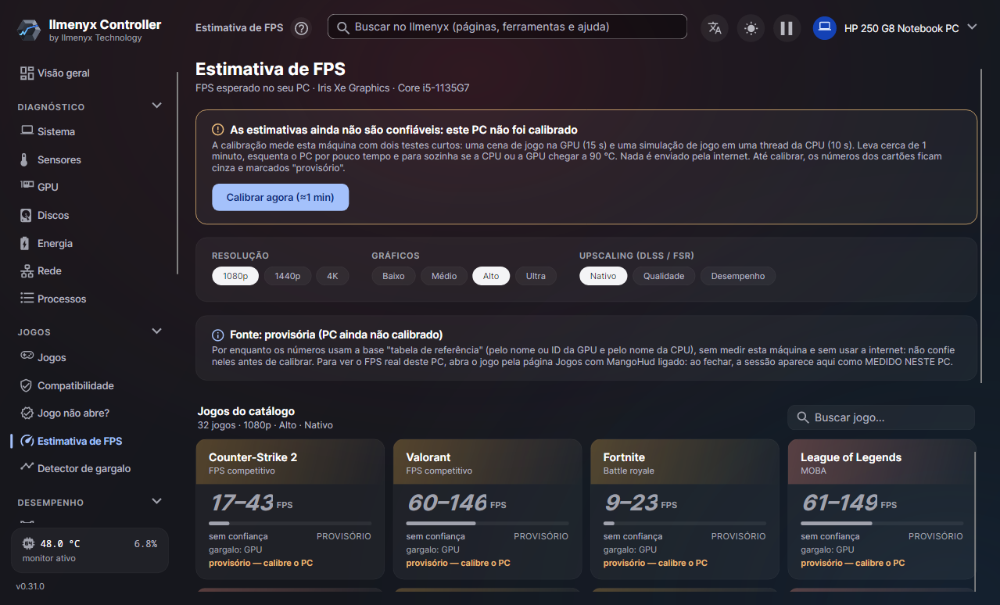
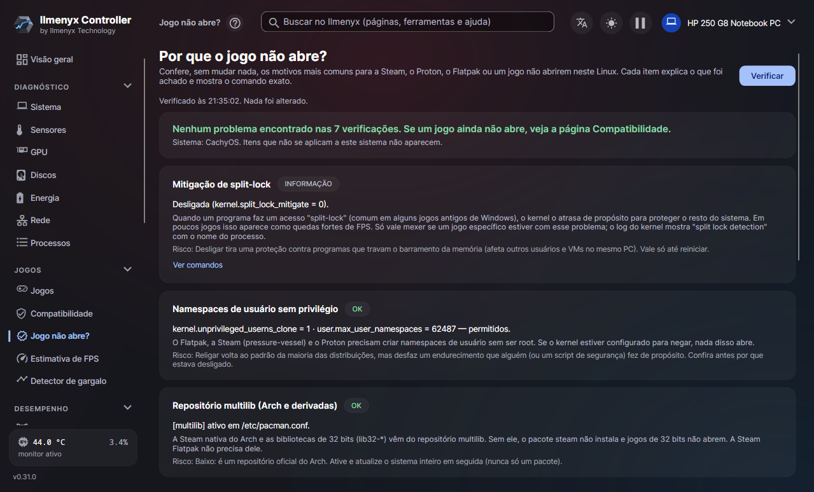
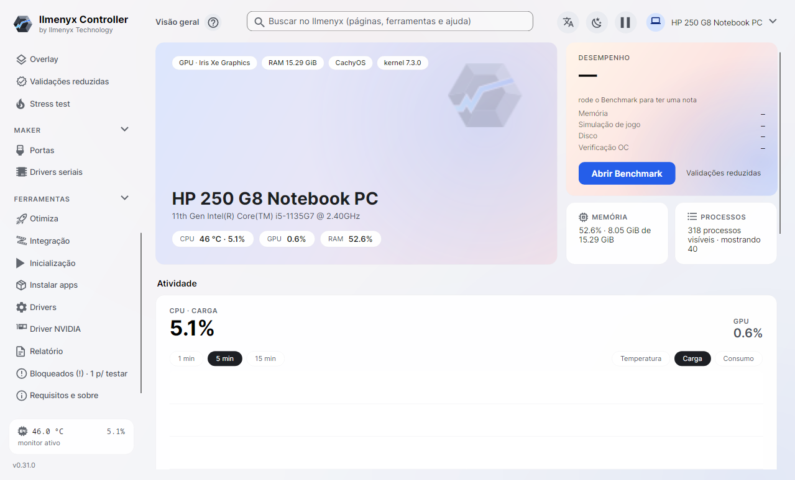

<p align="center"></p>

# Ilmenyx Controller

**English** · [Português](README.pt-BR.md)

**Hardware diagnostics, monitoring and benchmarking for Linux.**
By **Ilmenyx Technology**.


Ilmenyx Controller shows what is inside your computer (CPU, memory, GPU, disks, sensors, battery, network), measures its
performance and helps games run on Linux. It has a **desktop app** and a **command line** (`ilmenyx`), in **English,
Portuguese and Spanish**.

> **Pre-release.** It works and was validated on real hardware (Intel Iris Xe, AMD Radeon 610M, NVIDIA GeForce 940MX; CachyOS,
> Linux Mint), but not yet on every distro and GPU. What still needs testing is listed in [Sem_teste.md](Sem_teste.md) (Portuguese).



| | |
|---|---|
|  |  |
|  |  |

<sub>Screenshots in Portuguese; the app follows your system language or the one you pick in the header.</sub>

---

## Download

Get the latest version on the [releases](https://github.com/Ilmenyx-Technology/ilmenyx-controller/releases) page:

| File | For |
|---|---|
| `Ilmenyx-Controller-<version>-x86_64.AppImage` | **Recommended.** A single file, nothing to install: `chmod +x Ilmenyx-Controller-*.AppImage` and open it. Every feature. |
| `Ilmenyx-Controller-<version>-x86_64.flatpak` | If you prefer Flatpak: `flatpak install --user Ilmenyx-Controller-*.flatpak`. Some features haven't been tested in it yet ([docs/flatpak.md](docs/flatpak.md)). |
| `Ilmenyx-Controller-<version>-linux-x64.tar.gz` | Plain folder package, for technical users ([docs/pacote-linux-x64.md](docs/pacote-linux-x64.md)). |

No .NET install and no root needed: everything the app uses ships inside the package. Every file has a `.sha256` and an `.asc`
GPG signature; key fingerprint: `3D97 1657 2A39 8DCD D0CF  F0EE 733D 2EC7 8436 DCE8` ([how to verify](docs/assinatura-gpg.md)).

Found a problem or have an idea? Open an [issue](https://github.com/Ilmenyx-Technology/ilmenyx-controller/issues/new/choose) with your
distro, your graphics card and what happened (the app's **Report** page builds a hardware summary you can paste).

## What it does

| Area | What you get |
|---|---|
| **Diagnostics** | Live overview, system, sensors, GPU, disks (with imported SMART), power/battery, network and processes |
| **Games** | Library (Steam, Lutris, Heroic), compatibility (ProtonDB, Steam Deck, anti-cheat and reports from people with similar hardware), FPS estimate and bottleneck analysis |
| **Performance** | CPU, memory, GPU (Vulkan) and disk benchmarks; overclock checker; overlay; stress tests |
| **Maker** | Serial ports and board drivers (CH340, CP210x, FTDI) |
| **Tools** | Reversible tweaks, ZRAM, RGB through OpenRGB, startup apps, app installer (Flatpak), NVIDIA driver, HTML/JSON reports |
| **Windows games** | Installs Windows games (Proton/umu-launcher or its own Wine), "Why won't the game start?" diagnostics with one-click fixes |

Light and dark themes; every report is generated locally. Optional: minimize to the notification area, hot-CPU alerts and
new-version alerts.

## Principles

- **Read-only by default.** Reads `/proc`, `/sys` and `/etc`; opening the app changes nothing.
- **Load only when you click.** Benchmarks and stress tests ask first, have limits and stop on high temperature.
- **No hidden `sudo`.** Anything that needs root shows the exact command or script first and asks for your password.
- **No telemetry.** No data leaves your machine unless you ask.
- **No made-up data.** If a sensor doesn't exist, Ilmenyx says so instead of guessing.
- **No hidden network use.** The internet is only used after you confirm (e.g. compatibility lookups, the ProtonDB database).

## How to use it

1. Download the AppImage (see [Download](#download)), make it executable and open it. In the folder package, run
   `desktop/Ilmenyx.Desktop`; for a menu entry, run `packaging/linux/install-user.sh` (your user only, no root).
2. **No root or extra driver needed.** Temperatures come from the kernel's own modules (`k10temp` on AMD, `coretemp` on Intel).
3. **CPU temperature or power missing?** On first launch the app offers to unlock the sensors with **one** system password
   (Linux has hidden CPU power — RAPL — from regular users since 2020). You can also do it later from the sidebar and undo it
   in **Requirements and about**.
4. **FPS overlay:** turn it on in the Overlay page and start the game through Ilmenyx (or use the generated launch option).
   In game, **Ctrl + Shift + O** toggles the overlay (MangoHud, included in the package).
5. **Stress and benchmarks:** always with the temperature limit on and good airflow; everything asks first and can be canceled.
6. **Works on X11 and Wayland.** The app picks one; to force it, use `ILMENYX_DISPLAY_BACKEND=x11` or `wayland`.

Where data lives (nothing is shipped with the program): settings and history in `~/.config/ilmenyx/`, caches (compatibility,
components) in `~/.cache/ilmenyx/` and `~/.local/share/ilmenyx/`. To start over, delete those folders.

> **GPU:** NVIDIA cards show more details (VBIOS, power limits, CUDA) with the proprietary driver and `nvidia-smi`. On AMD the
> data comes from `amdgpu`. NVIDIA was validated on a laptop GeForce 940MX (driver 580, PRIME); dedicated AMD GPUs haven't been
> tested yet (the app says so).

## Building from source

### Requirements

- Linux x64 (glibc)
- [.NET 10 SDK](https://dotnet.microsoft.com/download)
- System graphics libraries for the desktop app: X11 or Wayland, fontconfig, EGL
- Vulkan loader, for the GPU benchmark

After building, run `ilmenyx doctor` to check what your machine is missing.

### Build and test

```bash
git clone --recurse-submodules https://github.com/Ilmenyx-Technology/ilmenyx-controller.git
cd ilmenyx-controller

export DOTNET_CLI_TELEMETRY_OPTOUT=1
dotnet restore Ilmenyx.slnx
dotnet build Ilmenyx.slnx -c Release --no-restore
dotnet test Ilmenyx.slnx -c Release --no-build --no-restore
```

### Run the app

```bash
dotnet run --project src/Ilmenyx.Desktop -c Release --no-build
```

### Build a self-contained package

```bash
scripts/package-linux-x64.sh /absolute/path/new-folder
```

The package includes the .NET runtime. Details in [docs/pacote-linux-x64.md](docs/pacote-linux-x64.md); AppImage and Flatpak
in [docs/appimage.md](docs/appimage.md) and [docs/flatpak.md](docs/flatpak.md).

## Command line

```bash
# Help and requirements check
ilmenyx --help
ilmenyx doctor

# Hardware inventory
ilmenyx info --json
ilmenyx info --html --output ~/ilmenyx-hardware.html

# Sensors
ilmenyx sensors --json

# SMART from a smartctl report you already have
ilmenyx smart-import --device nvme0n1 --html --output ~/smart.html < report.json

# Read-only checks
ilmenyx game-check
ilmenyx zram status
ilmenyx nvidia-driver status
```

From source, replace `ilmenyx` with `dotnet run --project src/Ilmenyx.Cli -c Release --no-build --`. The output file
(`--output`) must be **new**: Ilmenyx never overwrites files. The CLI speaks the same three languages (`ILMENYX_LANG=en|es|pt-BR`).

## Benchmarks

```bash
ilmenyx bench sim --json                              # light simulation
ilmenyx bench cpu --profile full --allow-cpu-load     # full CPU load
ilmenyx bench gpu-rt --allow-gpu-load                 # Vulkan ray tracing
```

Heavy modes need an explicit `--allow-*-load` flag. Methods in [docs/benchmarks-metodologia.md](docs/benchmarks-metodologia.md).

> Scores are **experimental**. Don't compare them with Windows scores and don't use them to conclude a machine is healthy or
> stable.

## Not there yet

Everything the original RESET EXPLODE does was ported or replaced with a Linux equivalent, with these exceptions:

| Item | Status | Why |
|---|---|---|
| GPU ray tracing benchmark | **Ported (Vulkan, ray query); validated only on a Radeon 610M APU** | Needs a dedicated AMD RX 6000+ / NVIDIA RTX; score not comparable to Windows |
| AMD/NVIDIA GPUs on real hardware | **Partial**: integrated AMD (Radeon 610M) and laptop NVIDIA (GeForce 940MX) validated | Missing dedicated AMD (own VRAM, fan, power limit) and desktop/RTX NVIDIA |
| RGB (Corsair, Razer) | Replaced by OpenRGB | The original SDKs are Windows-only; real LED control wasn't tested |
| `.deb`, `.rpm`, PKGBUILD, ARM64, musl packages | Not done | Today there are AppImage, Flatpak and `tar.gz` for linux-x64 |

The app shows this list in the **Blocked (!)** page. Full table: [docs/portagem-completa.md](docs/portagem-completa.md); everything
still to validate, with the reason and how to retest: [Sem_teste.md](Sem_teste.md). **Help with these items is welcome.**

## Project layout

```
src/
  Ilmenyx.Contracts/       shared types and contracts
  Ilmenyx.Core/            collection logic, benchmarks, translations
  Ilmenyx.Platform.Linux/  /proc, /sys and Linux integrations
  Ilmenyx.Gpu.Vulkan/      GPU benchmarks
  Ilmenyx.Cli/             command line (ilmenyx)
  Ilmenyx.Desktop/         desktop app (Avalonia 12)
tests/                     automated tests
tools/                     UI smoke test, translation tool, validations
scripts/                   packaging and validation
docs/                      technical documentation (mostly Portuguese)
upstream/ResetExplode/     original project (submodule)
```

## Documentation

The technical documentation is in Portuguese. Main entry points:

| Topic | Document |
|---|---|
| Architecture | [docs/arquitetura.md](docs/arquitetura.md) |
| Roadmap | [docs/roadmap-linux.md](docs/roadmap-linux.md) |
| Distro compatibility | [docs/compatibilidade-linux.md](docs/compatibilidade-linux.md) |
| Live monitor | [docs/monitor.md](docs/monitor.md) |
| How much the app itself uses | [docs/desempenho.md](docs/desempenho.md) |
| Languages and translations | [docs/idiomas.md](docs/idiomas.md) |
| Version history | [docs/historico-versoes.md](docs/historico-versoes.md) |
| Rules for agents and contributors | [AGENTS.md](AGENTS.md), [CONTRIBUTING.md](CONTRIBUTING.md) |

## Privacy and security

Reports can identify your machine (hardware, dates, labels). Review them before sharing; the automatic cleanup of obvious
patterns doesn't guarantee anonymity. Don't attach raw SMART output, dumps or logs with personal data.

See [PRIVACY.md](PRIVACY.md) and [SECURITY.md](SECURITY.md).

## Support the project

Ilmenyx is free and made by one person. If it helped you, a donation helps keep it going and buys hardware to test (AMD and NVIDIA
GPUs not validated yet). Donations are always optional: no feature depends on them.

| Pix (Brazil) | Other ways |
|---|---|
| <br>Random key:<br>`ad7075cc-cca1-4f12-9e11-f0d10890456a` | **Ko-fi** (card or PayPal, from any country):<br>[ko-fi.com/ilmenyxtechnology](https://ko-fi.com/ilmenyxtechnology)<br><br>**GitHub Sponsors:** coming soon |

## License and credits

Ilmenyx is **free of charge, with its source code available, but it isn't OSI open source**: the project's own code is under the
[PolyForm Noncommercial 1.0.0](LICENSE) with an [additional permission](LICENSES/LicenseRef-Ilmenyx-Permissao-Adicional.txt).

- **You can:** use it for free; use it as a tool in paid work (for example, diagnosing a client's PC and charging for the
  service); install it on a client's PC without charging for the app; make monetized videos and tutorials; redistribute the
  unmodified packages for free, without requiring sign-up or ads to download; modify it for internal company use.
- **You can't:** sell the app or modified versions, charge for access, offer it as a paid service or use its code in a paid
  product or service.
- Full explanation, in Portuguese (which prevails) and English: [LICENSING.md](LICENSING.md).

Ilmenyx is an **independent, unofficial** adaptation of [RESET EXPLODE](https://github.com/GustavoReset/ResetExplode), created by
Gustavo (GustavoReset), with no affiliation with or endorsement by the RESET team. The original is kept in the
`upstream/ResetExplode` submodule, with its license and history. The parts that come from it remain under **MIT**
([LICENSES/MIT.txt](LICENSES/MIT.txt)); the list of those files is in [NOTICE.md](NOTICE.md). Third-party components:
[THIRD-PARTY-NOTICES.md](THIRD-PARTY-NOTICES.md). Name and logo:
[LICENSES/LicenseRef-Ilmenyx-Marca.txt](LICENSES/LicenseRef-Ilmenyx-Marca.txt). Every file has an SPDX header
([REUSE](https://reuse.software)); the ones that can't are listed in [REUSE.toml](REUSE.toml).

External code contributions aren't accepted for now; issues are welcome ([CONTRIBUTING.md](CONTRIBUTING.md)).
