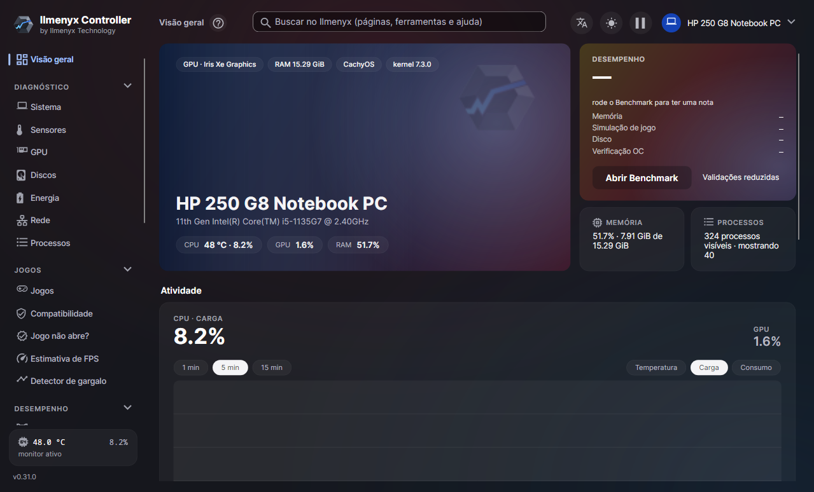
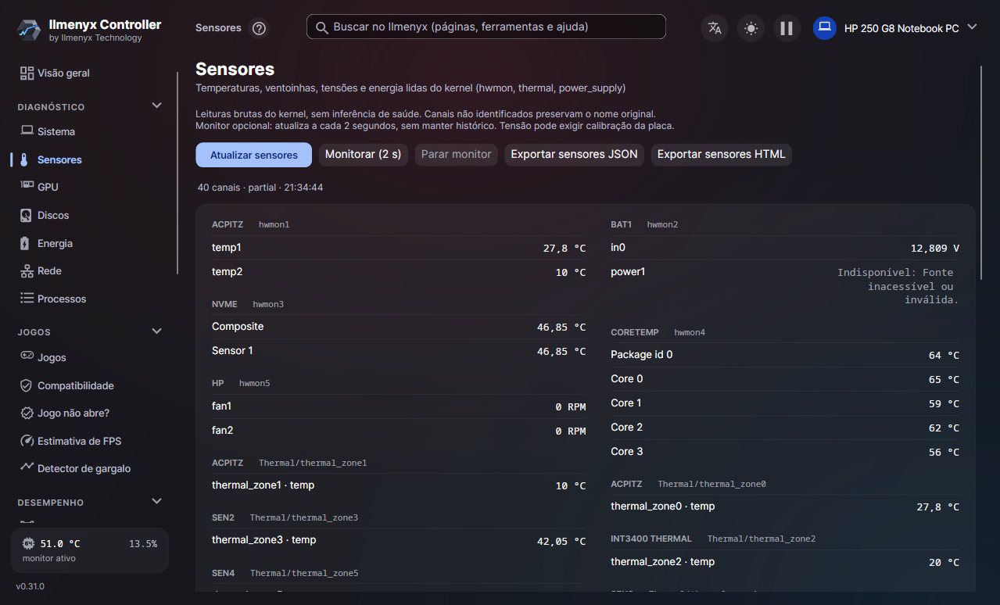
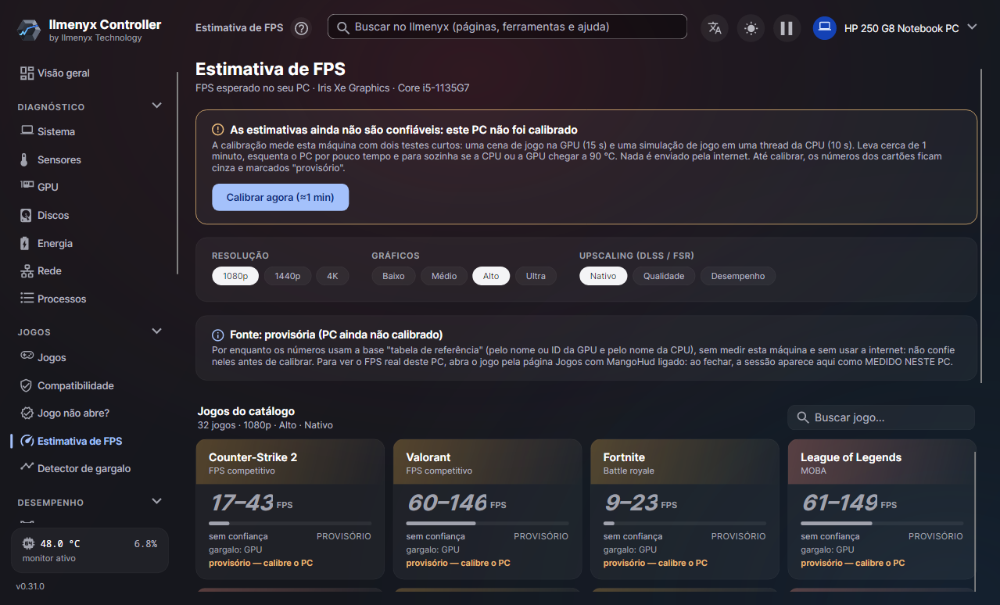
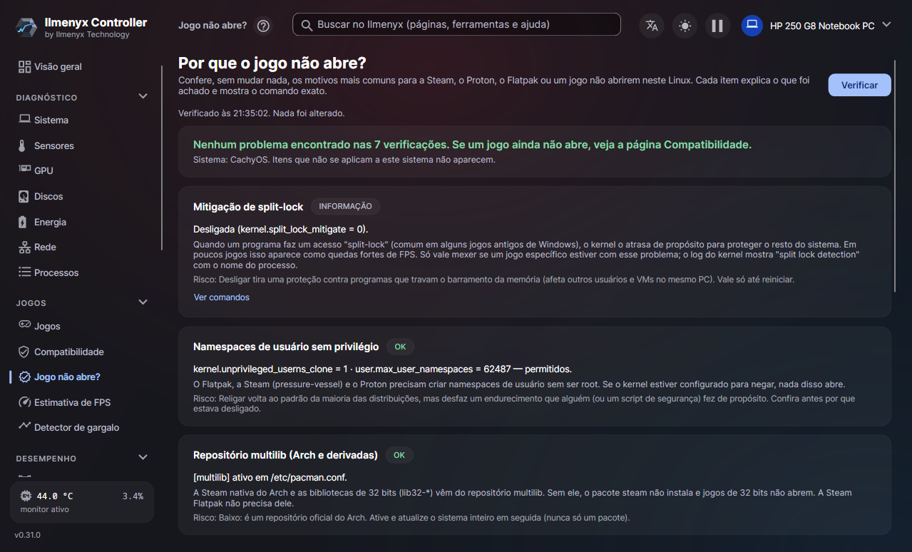
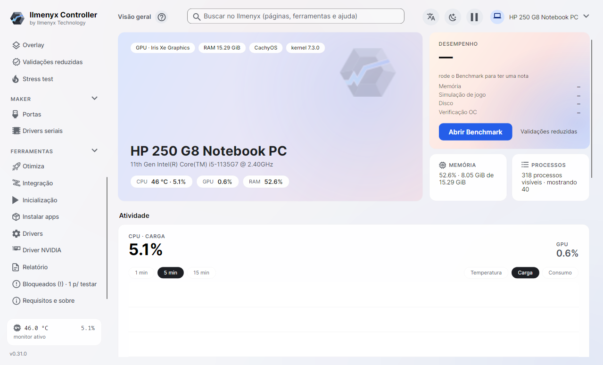

<p align="center"></p>

# Ilmenyx Controller

[English](README.md) · **Português**

**Diagnóstico, monitoramento e benchmark de hardware para Linux.**
Por **Ilmenyx Technology**.


O Ilmenyx Controller mostra o que há dentro do seu computador (CPU, memória, GPU, discos, sensores, bateria,
rede), mede o desempenho dele e ajuda a fazer jogos rodarem no Linux. Tem um **aplicativo desktop** e uma **linha de
comando** (`ilmenyx`), em **português, inglês e espanhol**.

> **Pré-lançamento.** Funciona e foi validado em hardware real (Intel Iris Xe, AMD Radeon 610M, NVIDIA GeForce 940MX; CachyOS,
> Linux Mint), mas ainda não em todas as distros e GPUs. O que falta testar está em [Sem_teste.md](Sem_teste.md).



| | |
|---|---|
|  |  |
|  |  |

---

## Baixar

Na página de [releases](https://github.com/Ilmenyx-Technology/ilmenyx-controller/releases), pegue a versão mais recente:

| Arquivo | Para quem |
|---|---|
| `Ilmenyx-Controller-<versão>-x86_64.AppImage` | **Recomendado.** Um arquivo só, sem instalar: `chmod +x Ilmenyx-Controller-*.AppImage` e abrir. Todos os recursos. |
| `Ilmenyx-Controller-<versão>-x86_64.flatpak` | Quem prefere Flatpak: `flatpak install --user Ilmenyx-Controller-*.flatpak`. Alguns recursos ainda não foram testados nele ([docs/flatpak.md](docs/flatpak.md)). |
| `Ilmenyx-Controller-<versão>-linux-x64.tar.gz` | Pacote em pasta, para técnicos ([docs/pacote-linux-x64.md](docs/pacote-linux-x64.md)). |

Não precisa instalar o .NET nem ser root: tudo o que o app usa vai dentro do pacote. Cada arquivo tem `.sha256` e assinatura
`.asc`; impressão digital da chave: `3D97 1657 2A39 8DCD D0CF  F0EE 733D 2EC7 8436 DCE8` ([como conferir](docs/assinatura-gpg.md)).

Achou um problema ou tem uma ideia? Abra uma [issue](https://github.com/Ilmenyx-Technology/ilmenyx-controller/issues) dizendo a distro, a
placa de vídeo e o que aconteceu (a página **Relatório** do app gera um resumo do hardware para colar).

## O que ele faz

| Área | O que você encontra |
|---|---|
| **Diagnóstico** | Visão geral ao vivo, sistema, sensores, GPU, discos (com SMART importado), energia/bateria, rede e processos |
| **Jogos** | Biblioteca (Steam, Lutris, Heroic), compatibilidade (ProtonDB, Steam Deck, anti-cheat e relatos de quem tem hardware parecido), estimativa de FPS e análise de gargalo |
| **Desempenho** | Benchmarks de CPU, memória, GPU (Vulkan) e disco; verificador de overclock; overlay; testes de estresse |
| **Maker** | Portas seriais e drivers de placas (CH340, CP210x, FTDI) |
| **Ferramentas** | Otimizações reversíveis, ZRAM, RGB via OpenRGB, apps de inicialização, instalação de apps (Flatpak), driver NVIDIA, relatórios HTML/JSON |
| **Jogos de Windows** | Instala jogos de Windows (Proton/umu-launcher ou Wine próprio), diagnóstico "Por que o jogo não abre?" com correções de um clique |

O app tem tema claro e escuro, e todos os relatórios são gerados localmente. Opcionais: minimizar para a área de notificação,
aviso de CPU quente e aviso de versão nova.

## Princípios

- **Somente leitura por padrão.** Lê `/proc`, `/sys` e `/etc`; não altera o sistema ao abrir.
- **Carga só com o seu clique.** Benchmarks e stress pedem confirmação, têm limites e cortam por temperatura.
- **Sem `sudo` escondido.** O que exige root mostra antes o comando ou o script exato e pede a sua senha.
- **Sem telemetria.** Nenhum dado sai da sua máquina sem você pedir.
- **Sem dados inventados.** Se um sensor não existe, o Ilmenyx diz isso em vez de estimar.
- **Sem rede escondida.** A internet só é usada quando você confirma (ex.: consulta de compatibilidade, base do ProtonDB).

## Como usar

1. Baixe o AppImage (veja [Baixar](#baixar)), dê permissão de execução e abra. No pacote em pasta, rode `desktop/Ilmenyx.Desktop`;
   para ter o ícone no menu, rode `packaging/linux/install-user.sh` (só no seu usuário, sem root).
2. **Não precisa de root nem de driver extra.** As temperaturas vêm dos módulos do próprio kernel (`k10temp` na AMD, `coretemp` na Intel).
3. **Temperatura ou consumo da CPU não aparecem?** Na primeira vez o app oferece liberar os sensores com **uma senha** do sistema (o
   Linux esconde o consumo da CPU — RAPL — do usuário comum desde 2020). Dá para fazer depois pelo menu lateral e desfazer em
   **Requisitos e sobre**.
4. **Overlay de FPS:** ligue na página Overlay e inicie o jogo pelo Ilmenyx (ou use a opção de inicialização gerada). No jogo, **Ctrl + Shift + O**
   liga e desliga o overlay (MangoHud, incluído no pacote).
5. **Stress e benchmarks:** sempre com o limite de temperatura ligado e boa ventilação; tudo pede confirmação e pode ser cancelado.
6. **Funciona em X11 e Wayland.** O app escolhe sozinho; para forçar, use `ILMENYX_DISPLAY_BACKEND=x11` ou `wayland`.

Onde ficam os dados (nada vai junto com o programa): configurações e histórico em `~/.config/ilmenyx/`, caches (compatibilidade,
componentes) em `~/.cache/ilmenyx/` e `~/.local/share/ilmenyx/`. Para começar do zero, apague essas pastas.

> **GPU:** placas NVIDIA mostram mais detalhes (VBIOS, limites de energia, CUDA) com o driver proprietário e o `nvidia-smi`.
> Em AMD os dados vêm do `amdgpu`. NVIDIA foi validada numa GeForce 940MX de notebook (driver 580, PRIME); GPU AMD dedicada ainda não foi testada (aviso no app).

## Começando

### Requisitos

- Linux x64 (glibc)
- [SDK .NET 10](https://dotnet.microsoft.com/download)
- Bibliotecas gráficas do sistema para o app desktop: X11 ou Wayland, fontconfig, EGL
- Loader Vulkan, para o benchmark de GPU

Para checar o que falta na sua máquina depois de compilar, rode `ilmenyx doctor`.

### Compilar e testar

```bash
git clone --recurse-submodules https://github.com/Ilmenyx-Technology/ilmenyx-controller.git
cd ilmenyx-controller

export DOTNET_CLI_TELEMETRY_OPTOUT=1
dotnet restore Ilmenyx.slnx
dotnet build Ilmenyx.slnx -c Release --no-restore
dotnet test Ilmenyx.slnx -c Release --no-build --no-restore
```

### Abrir o aplicativo

```bash
dotnet run --project src/Ilmenyx.Desktop -c Release --no-build
```

Para forçar o servidor gráfico, use `ILMENYX_DISPLAY_BACKEND=x11` ou `ILMENYX_DISPLAY_BACKEND=wayland`.

### Gerar um pacote autocontido

```bash
scripts/package-linux-x64.sh
```

O pacote inclui o runtime .NET. Detalhes em [docs/pacote-linux-x64.md](docs/pacote-linux-x64.md).

## Usando a linha de comando

```bash
# Ajuda e verificação de requisitos
dotnet run --project src/Ilmenyx.Cli -c Release --no-build -- --help
dotnet run --project src/Ilmenyx.Cli -c Release --no-build -- doctor

# Inventário de hardware
... -- info --json
... -- info --html --output ~/ilmenyx-hardware.html

# Sensores
... -- sensors --json

# SMART a partir de um relatório do smartctl que você já tem
... -- smart-import --device nvme0n1 --html --output ~/smart.html < relatorio.json
```

Em `...`, use o prefixo `dotnet run --project src/Ilmenyx.Cli -c Release --no-build`.
Depois de compilar, o executável também fica em `src/Ilmenyx.Cli/bin/Release/net10.0/ilmenyx`.

O arquivo de saída (`--output`) precisa ser **novo**: o Ilmenyx não sobrescreve arquivos.

## Benchmarks

```bash
... -- bench sim --json                                  # simulação leve
... -- bench cpu --profile full --allow-cpu-load         # carga total da CPU
... -- bench sim-full --allow-cpu-load                  # simulação completa
```

Os modos `full` geram carga pesada e exigem `--allow-cpu-load`. Métodos em
[docs/benchmarks-metodologia.md](docs/benchmarks-metodologia.md).

> Os scores são **experimentais**. Não os compare com os do Windows e não os use para concluir
> que uma máquina está saudável ou estável.

## O que ainda não funciona

O que o RESET EXPLODE original faz foi portado ou substituído por um equivalente Linux, com estas exceções:

| Item | Situação | Motivo |
|---|---|---|
| Benchmark de GPU com ray tracing | **Portado (Vulkan, ray query); validado só numa APU Radeon 610M** | Falta GPU dedicada AMD RX 6000+ / NVIDIA RTX; score não comparável ao Windows |
| GPU AMD/NVIDIA em hardware real | **Parcial**: AMD integrada (Radeon 610M) e NVIDIA de notebook (GeForce 940MX) validadas | Falta GPU AMD dedicada (VRAM própria, ventoinha, limite de energia) e NVIDIA de desktop/RTX |
| RGB (Corsair, Razer) | Substituído pelo OpenRGB | Os SDKs originais são do Windows; o controle real de LEDs não foi testado |
| Pacotes `.deb`, `.rpm`, PKGBUILD, ARM64, musl | Não feito | Hoje há AppImage, Flatpak e `tar.gz` para linux-x64 |

O aplicativo mostra essa lista na página **Bloqueados (!)**. O que não existe no Linux (ajustes do Windows, limpeza de USB fantasma, WinRAR) saiu da lista: ver [docs/bloqueados-removidos.md](docs/bloqueados-removidos.md). A tabela completa está em
[docs/portagem-completa.md](docs/portagem-completa.md) e tudo que falta validar, com o motivo e como
retestar, está em [Sem_teste.md](Sem_teste.md). **Contribuições para esses itens são bem-vindas.**

## Estrutura do projeto

```
src/
  Ilmenyx.Contracts/       tipos e contratos compartilhados
  Ilmenyx.Core/            lógica de coleta e benchmarks
  Ilmenyx.Platform.Linux/  leitura de /proc, /sys e integrações do Linux
  Ilmenyx.Gpu.Vulkan/      benchmark de GPU
  Ilmenyx.Cli/             linha de comando (ilmenyx)
  Ilmenyx.Desktop/         aplicativo desktop (Avalonia 12)
tests/                     testes automatizados
tools/                     smoke da interface e validações
scripts/                   empacotamento e validação
docs/                      documentação técnica
upstream/ResetExplode/     projeto original (submódulo)
```

## Documentação

| Assunto | Documento |
|---|---|
| Arquitetura | [docs/arquitetura.md](docs/arquitetura.md) |
| Roadmap | [docs/roadmap-linux.md](docs/roadmap-linux.md) |
| Validação e evidências | [docs/validacao.md](docs/validacao.md) |
| Compatibilidade entre distros | [docs/compatibilidade-linux.md](docs/compatibilidade-linux.md) |
| Monitor ao vivo | [docs/monitor.md](docs/monitor.md) |
| SMART importado | [docs/smart-import.md](docs/smart-import.md) |
| Histórico de versões | [docs/historico-versoes.md](docs/historico-versoes.md) |
| Quanto o próprio app gasta | [docs/desempenho.md](docs/desempenho.md) |
| Idiomas | [docs/idiomas.md](docs/idiomas.md) |
| Regras para agentes e contribuidores | [AGENTS.md](AGENTS.md), [CONTRIBUTING.md](CONTRIBUTING.md) |

## Privacidade e segurança

Relatórios podem identificar a sua máquina (hardware, datas, rótulos). Revise antes de compartilhar;
a limpeza automática de padrões óbvios não garante anonimato. Não anexe saída bruta de SMART, dumps
ou logs com dados pessoais.

Veja [PRIVACY.md](PRIVACY.md) e [SECURITY.md](SECURITY.md).

## Apoie o projeto

O Ilmenyx é gratuito e feito por uma pessoa só. Se ele te ajudou, uma doação ajuda a manter o desenvolvimento e a comprar hardware
para testar (GPUs AMD e NVIDIA que ainda não foram validadas). Doação é sempre opcional: nenhuma função do app depende dela.

| Pix (Brasil) | Outras formas |
|---|---|
| <br>Chave aleatória:<br>`ad7075cc-cca1-4f12-9e11-f0d10890456a` | **Ko-fi** (cartão ou PayPal, de qualquer país):<br>[ko-fi.com/ilmenyxtechnology](https://ko-fi.com/ilmenyxtechnology)<br><br>**GitHub Sponsors:** em breve |

## Licença e créditos

O Ilmenyx é **gratuito, mas não é open source**: o código próprio está sob a
[PolyForm Noncommercial 1.0.0](LICENSE) com uma [permissão adicional](LICENSES/LicenseRef-Ilmenyx-Permissao-Adicional.txt).

- **Pode:** usar de graça; usar como ferramenta em trabalho pago (por exemplo, diagnosticar o PC de um
  cliente e cobrar pelo serviço); instalar no PC do cliente sem cobrar pelo app; fazer vídeos e
  tutoriais monetizados; redistribuir os pacotes sem modificação de graça, sem exigir cadastro ou
  anúncio para baixar; modificar para uso interno da empresa.
- **Não pode:** vender o app ou versões modificadas, cobrar pelo acesso, oferecê-lo como serviço pago ou
  usar o código dele em produto ou serviço pago.
- Explicação completa, em português (que prevalece) e inglês: [LICENSING.md](LICENSING.md).

O Ilmenyx é uma adaptação **independente e não oficial** do
[RESET EXPLODE](https://github.com/GustavoReset/ResetExplode), criado por Gustavo (GustavoReset), sem
afiliação ou endosso da equipe RESET. O original fica no submódulo `upstream/ResetExplode`, com
licença e histórico preservados. Os trechos que vêm dele continuam sob a **MIT**
([LICENSES/MIT.txt](LICENSES/MIT.txt)); a lista desses arquivos está em [NOTICE.md](NOTICE.md).
Componentes de terceiros: [THIRD-PARTY-NOTICES.md](THIRD-PARTY-NOTICES.md). Nome e logo:
[LICENSES/LicenseRef-Ilmenyx-Marca.txt](LICENSES/LicenseRef-Ilmenyx-Marca.txt). Cada arquivo traz um
cabeçalho SPDX ([REUSE](https://reuse.software)); os que não podem trazer estão em [REUSE.toml](REUSE.toml).

Contribuições de código externas não são aceitas por enquanto; issues são bem-vindas
([CONTRIBUTING.md](CONTRIBUTING.md)).
